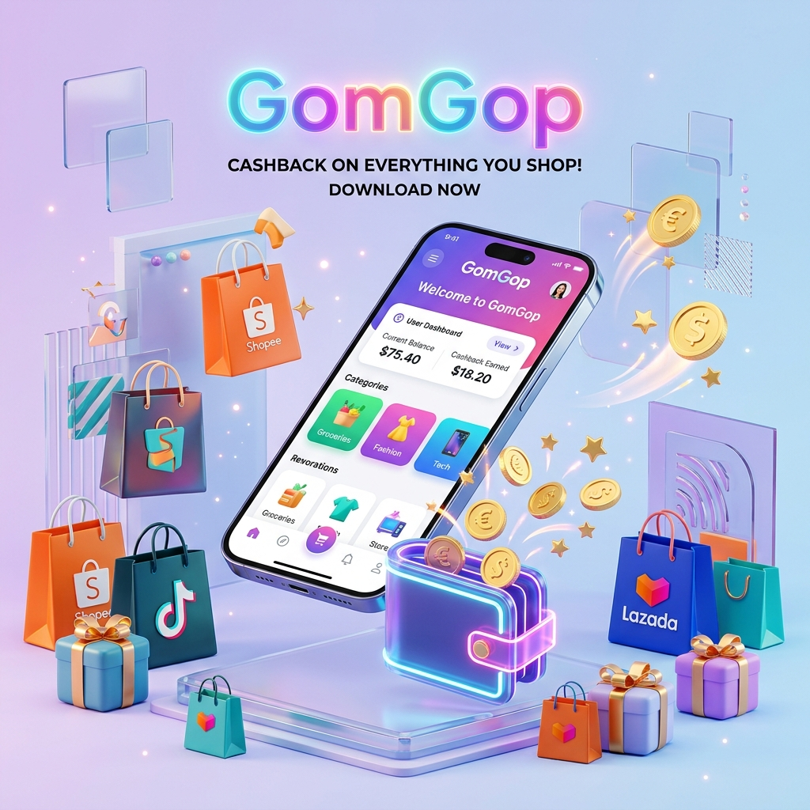
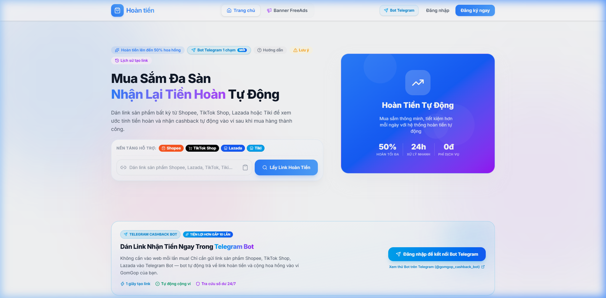
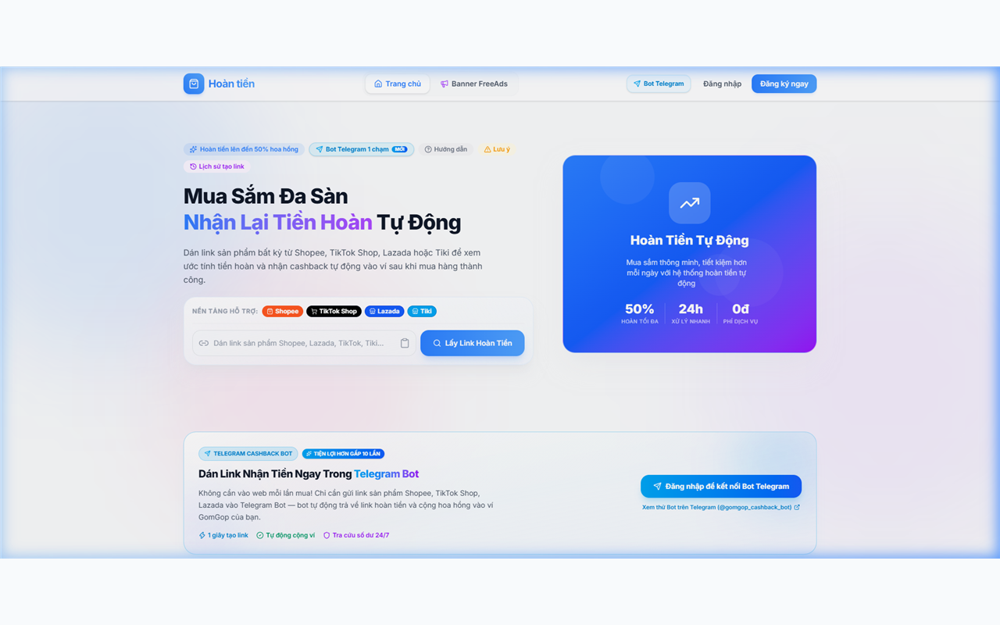

# 🛍️ NỀN TẢNG TIẾP THỊ LIÊN KẾT & HOÀN TIỀN MUA SẮM ĐA SÀN (CASHBACK & AFFILIATE PLATFORM)

  

  
  
  

---

## 🌟 GIỚI THIỆU TỔNG QUAN

**Shopee / Lazada / TikTok Shop Cashback Platform** là giải pháp phần mềm hoàn chỉnh giúp bạn xây dựng và vận hành một nền tảng **Hoàn tiền mua sắm & Tiếp thị liên kết (Affiliate MLM 2 tầng)** chuyên nghiệp tương tự ShopBack, Tích Lũy, hoặc [GomGop.net](https://gomgop.net).

Hệ thống được thiết kế theo kiến trúc module hóa linh hoạt:
- **Tùy chọn hạ tầng 0 VNĐ/tháng:** Chạy hoàn toàn trên nền tảng Serverless (Cloudflare Pages + Cloudflare Workers + Google Firebase Free Tier).
- **Tùy chọn 1 Server riêng (Single VPS Docker):** Triển khai All-in-One trên 1 máy chủ VPS (Nginx + Node.js + Cron nội bộ), làm chủ 100% tài nguyên và dữ liệu, không giới hạn lượng request.
- **Hệ sinh thái Addon Extensions:** Bộ 3 tiện ích trình duyệt độc quyền giúp tối đa hóa tỷ lệ chuyển đổi và giải quyết triệt để bài toán đồng bộ đơn hàng từ sàn thương mại điện tử.

> 🌐 **Trải nghiệm sản phẩm thực tế đang vận hành tại:** [https://gomgop.net](https://gomgop.net)

---

## 📸 HÌNH ẢNH MẪU THỰC TẾ HỆ THỐNG

### 1. Giao diện Web App PWA (Tối ưu Mobile & Desktop)
Giao diện hiện đại xây dựng trên **React 19 + TailwindCSS**, hỗ trợ giao diện Sáng/Tối (Dark/Light mode), tích hợp sẵn công cụ dán link nhận hoa hồng tức thì, săn deal giảm giá và bảng xếp hạng thành viên.

  

---

### 2. Tiện Ích Trình Duyệt Cho Người Mua (User Browser Extension)
Hỗ trợ đầy đủ **Google Chrome, Microsoft Edge, Mozilla Firefox và Cốc Cốc**. Tự động phát hiện khi khách xem sản phẩm trên Shopee/Lazada và hiển thị nút kích hoạt hoàn tiền 1-chạm mà không cần phải mở lại trang web.

  

  

---

### 3. Tự Động Hóa 1-Chạm Qua Telegram Bot & Zalo Bot
Tích hợp bot thông minh giúp người dùng gửi link trực tiếp trong ứng dụng nhắn tin hàng ngày để nhận link hoàn tiền trong 1 giây.

  

---

## ⚡ CÁC TÍNH NĂNG CỐT LÕI VƯỢT TRỘI

### 1. Phía Người Dùng (Client Web App)
- **Rút gọn link & Tự động gắn SubID:** Hỗ trợ link Shopee, Lazada, TikTok Shop. Hệ thống tự động bóc tách link, gắn mã SubID theo định dạng bảo mật riêng cho từng user.
- **Tiếp thị liên kết 2 tầng (F1, F2):** Người dùng mời bạn bè đăng ký sẽ nhận hoa hồng thụ động (F1: 10%, F2: 5%) từ mọi đơn hàng phát sinh trọn đời.
- **Ví tiền minh bạch & Rút tiền tự động:** Quản lý số dư khả dụng, số dư tạm giữ (chờ sàn đối soát). Tích hợp rút tiền tự động qua **PayOS / VietQR** về mọi ngân hàng Việt Nam 24/7.
- **Gamification giữ chân người dùng:**
  - Điểm danh nhận Xu hàng ngày (Daily Check-in Streak).
  - Vòng quay may mắn (Lucky Wheel).
  - Đổi điểm nhận quà / mã giảm giá.
  - Bảng xếp hạng đua top tích lũy hoàn tiền theo tuần/tháng.
- **Thông báo đa kênh:** Web Push Notification (ngay cả khi tắt trình duyệt) + Telegram Bot thông báo biến động số dư.

### 2. Phía Quản Trị Viên (Admin Management Portal)
- **Dashboard tài chính tổng thể:** Doanh thu sàn, tổng hoa hồng trả khách, lợi nhuận ròng của hệ thống theo thời gian thực.
- **Cấu hình tỷ lệ hoa hồng linh hoạt:** Tùy biến tỷ lệ hoàn tiền cho F0, hoa hồng cho tuyến F1, F2 và % giữ lại cho chủ website.
- **Quản lý & Duyệt đơn hàng:** Quản lý hàng triệu click tracking và đơn hàng đối soát. Hỗ trợ duyệt rút tiền thủ công hoặc bật chế độ tự động chi hộ PayOS.
- **Cấu hình nhà cung cấp API:** Bật/tắt linh hoạt các nguồn API sàn (Shopee Open API, Addlivetag API, TichCop, Lazada Open API, TikTok Partner, Accesstrade).

### 3. Giải Pháp Dự Phòng 3 Lớp Vượt Rào API Shopee
Đây là **ưu thế công nghệ độc quyền** của hệ thống, giúp bạn không bao giờ bị gián đoạn hoạt động:
1. **Lớp 1:** Shopee Open API chính thức (khi có App Key & Secret).
2. **Lớp 2:** Tích hợp Addlivetag API & TichCop (bên thứ 3 ổn định, lấy dữ liệu và hoa hồng tức thì).
3. **Lớp 3: Admin Sync Extension:** Tiện ích dành riêng cho Admin để cào đơn và dữ liệu tài chính trực tiếp từ portal `affiliate.shopee.vn` nếu sàn chưa duyệt API hoặc API bị nghẽn.

---

## 📦 BẢNG PHÂN LOẠI CÁC GÓI SẢN PHẨM

Chúng tôi cung cấp các gói mã nguồn được đóng gói sẵn phù hợp với từng nhu cầu và ngân sách:

| Tính Năng / Quyền Lợi | GÓI 1: BASIC SERVERLESS | GÓI 2: PRO SERVERLESS | GÓI 3: BASIC VPS | GÓI 4: ULTIMATE VPS |
| :--- | :---: | :---: | :---: | :---: |
| **Giao diện Web App PWA (React 19)** | ✅ | ✅ | ✅ | ✅ |
| **Admin Portal Quản Trị Đầy Đủ** | ✅ | ✅ | ✅ | ✅ |
| **Đối Soát Đơn Hàng Đa Sàn Tự Động** | ✅ | ✅ | ✅ | ✅ |
| **Rút Tiền Tự Động VietQR / PayOS** | ✅ | ✅ | ✅ | ✅ |
| **Gamification (Vòng quay, Điểm danh)** | ✅ | ✅ | ✅ | ✅ |
| **Bot Telegram Cá Nhân & Báo Động** | ✅ | ✅ | ✅ | ✅ |
| **Tiện ích Trình duyệt cho Khách (Addon)** | ❌ | ✅ **Có** | ❌ | ✅ **Có** |
| **Admin Sync Extension (Cào đơn Shopee)** | ❌ | ✅ **Có** | ❌ | ✅ **Có** |
| **Zalo Bot Extension (Tự động nhóm Zalo)** | ❌ | ✅ **Có** | ❌ | ✅ **Có** |
| **Mô Hình Hạ Tầng Triển Khai** | **Serverless (0đ/tháng)** | **Serverless (0đ/tháng)** | **1 Server VPS (Docker)** | **1 Server VPS (Docker)** |
| **Chi Phí Máy Chủ Hàng Tháng** | **0 VNĐ** | **0 VNĐ** | **~80k - 150k VNĐ** | **~80k - 150k VNĐ** |
| **Tài Liệu Hướng Dẫn Kèm Theo** | ✅ Chi tiết A-Z | ✅ Chi tiết A-Z | ✅ Chi tiết A-Z | ✅ Chi tiết A-Z |

---

## 🛠️ CÔNG NGHỆ SỬ DỤNG (TECH STACK)

- **Frontend:** React 19, Vite, TailwindCSS, Lucide Icons, PWA (Progressive Web App).
- **Backend API & Engine:** Cloudflare Workers (Serverless) / Node.js 20+ Express/Hono (Bản VPS).
- **Database & Auth:** Google Firebase Auth (Google Sign-In) + Cloud Firestore NoSQL Database.
- **Tiện ích Trình duyệt:** WebExtension Manifest V3 (Vanilla JS, tương thích Chrome, Edge, Firefox, Cốc Cốc).
- **Thanh toán:** Tích hợp PayOS Webhook & VietQR Auto Payout.
- **Tự động hóa & Lịch trình:** Cloudflare Cron Triggers / Linux `node-cron` định kỳ 15 phút/lần.
- **Containerization (Bản VPS):** Docker, Docker Compose, Nginx, Let's Encrypt SSL.

---

## 📞 LIÊN HỆ TƯ VẤN & BÁO GIÁ SỞ HỮU SOURCE CODE

Nếu bạn đang tìm kiếm một hệ thống hoàn tiền & tiếp thị liên kết chuẩn mực, hoạt động ổn định và sẵn sàng sinh lời ngay lập tức, vui lòng liên hệ trực tiếp với tác giả:

| Kênh Liên Hệ | Thông Tin Chi Tiết |
| :--- | :--- |
| 💬 **Telegram Trực Tiếp** | [@crazykenvn](https://t.me/crazykenvn) *(Ưu tiên phản hồi nhanh)* |
| 📱 **Zalo / Hotline** | [0968.586.183](https://zalo.me/0968586183) *(Hỗ trợ tư vấn & Demo)* |
| ✉️ **Email Hợp Tác** | [crazykenvn@gmail.com](mailto:crazykenvn@gmail.com) |
| 🌐 **Website Demo Trực Tiếp** | [https://gomgop.net](https://gomgop.net) |

> 🤝 **Chính sách hỗ trợ:**
> - Hỗ trợ hướng dẫn cấu hình API sàn, Firebase, Cloudflare / VPS từ A-Z.
> - Hỗ trợ đổi thương hiệu, logo, tên miền riêng theo yêu cầu (White-labeling).
> - Nhận tùy biến thêm tính năng hoặc sàn thương mại điện tử riêng biệt.

---

  <i>Được phát triển và tối ưu hóa bởi <a href="https://github.com/crazykenvn">crazykenvn</a>. Mọi quyền được bảo lưu.</i>

